**ℹ️ Read this document fully before following its steps.**

# Adding API support for data in Visitz

API support in the Visitz app has a multi-layer system dependency.

## Prerequisites

### ICM API availability

ICM is the main system we are ultimately connecting to—APIs we want to use must be implemented there. 

It is recommended to wait for new APIs to stabilize in ICM before hooking them up in our architecture. You could start development on an agreed structure, but it may change before moving to production. Your mileage may vary.

Work with relevant business areas/teams to add/modify ICM APIs. If the APIs already exist and fulfill your needs, you can immediately proceed without new ICM development.

### Visitz API external backend support

For the Visitz app to interface with ICM, it must go through the [Visitz API (VPI)](https://github.com/bcgov/visitz-api) middleware.

Any ICM API that is available must be added as a VPI endpoint to be used in Visitz app.

## Visitz app internal backend support

Once external API support is available at both levels above we can finally implement support for it in the app itself.

### Visual overview

```mermaid
flowchart TD
    start([Start])
    exApi[External API]
    vpi[VPI]
    models[DB Models]
    ui[User interface]
    svcs[API Services]
    db[(Local database)]

    subgraph visitz[Visitz C# project]
        style visitz fill:#004400
        ui
        svcs
    end

    subgraph visitzApi[VisitzApi C# project]
        style visitzApi fill:#004F52
       vpi
    end

    subgraph visitzModel[VisitzModel C# project]
        style visitzModel fill:#00025C
        models
    end

    subgraph local[Local device]
        db
        visitz
        visitzApi
        visitzModel
    end

    subgraph internet[Internet]
        exApi
    end

    start -->|Initiate API call| ui

    ui --> |Subscribe to database changes| models
    ui --> |Invoke serivce| svcs

    svcs <--> |1. Get data #40;in parallel#41;| vpi
    svcs --> |2. Store data #40;serially#41;| models

    vpi <--> |Make network call| exApi

    models <--> |Synchronize existing data| db
    models --> |Notify subscribers of changed data| ui
```


### Connect to Visitz API backend

Communication with Visitz API is handled by the [VisitzApi csproject](../../visitz/VisitzApi). The code in this csproject is Visitz' side of interacting with the API, it does not contain the actual TypeScript API code (see [Visitz API external backend support](#visitz-api-external-backend-support)).

It uses `internal` [`VisitzBaseEndpoint`](../../visitz/VisitzApi/Endpoints)s to set up how to connect to specific APIs. Each HTTP verb gets its own endpoint class, even if they use the same URL route (e.g. `GetAttachmentsEndpoint` & `PostAttachmentEndpoint`).

Use [Pagination](../../visitz/VisitzApi/Requests/Pagination.cs) to facilitate request pagination.

JSON models for parsing responses and creating requests are in [VisitzApi.Models](../../visitz/VisitzApi/Models). Models' properties should be named the closest PascalCase equivalent to the real field names from Visitz API when using the [PayloadOptions.SiebelGet](../../visitz/VisitzApi/Json/PayloadOptions.cs) `JsonSerializerOptions` to parse.

`VisitzApi` is externally driven using the [Vpi](../../visitz/VisitzApi/Vpi.cs) class.

> ⚠️ There isn't yet an easy way to integration test real API calls, so you can either:
>
> - Skip ahead and create/modify the API service needed for this work, then add a new debug option to initiate the service
> - Temporarily add code to some other view (don't commit it!)
> - Create a temporary test file in [VisitzApiTest](../../visitz/VisitzApiTest), manually paste in a fresh JWT, and use a Test run to drive the call (note no automatic refresh)
>
> This is assuming you have not yet created the UI that initiates the service or your new service is not run by a different, already wired-in service.

### Storing data on device

Data is stored encrypted using [MongoDB Dotnet Realm](https://www.mongodb.com/docs/atlas/device-sdks/sdk/dotnet) ([GitHub repo](https://github.com/realm/realm-dotnet)).
---


Database models are in [VisitzModel.Models](../../visitz/VisitzModel/Models).  You will most likely need to create new models for your use-case. It's recommended to use the same database model for storing both ICM data and user drafts.

When creating a new model (a class that implements `IRealmObject`), be sure to annotate the class declaration so binding properties can be automatically generated (see [Example](#example) later in this doc). We use the generated properties to bind models to the UI without causing errors.

#### ICM data

All data downloaded from ICM goes into the `IcmData` Realm.

#### User drafts

User-generated data, like drafts, goes into the `UserData` Realm.

Historically, each draft type would get its own Realm to reduce the blast radius in case a Realm got corrupted, but there have been no reports of this happening in the wild. The added complexity to support this is not worth it, so when feasible, we want to migrate user drafts into `UserData`.

### Services to drive API requests and processing

---

Visitz app uses `VisitzService`s (and derived types) to drive all of its API calls + processing, background work, and any long-running task:

- Frontend code is intended to use a [pub/sub mechanism (.NET MVVM Messenger)](https://learn.microsoft.com/en-us/dotnet/communitytoolkit/mvvm/messenger) to initiate services and subscribe to their status updates.
- Backend code (mainly the services themselves) is intended to drive services directly with async/await.

There are a bunch of base implementations ready for different kinds of services:

- `VisitzService`: base implementation with lifecycle and status updates. Use this for any work that does not already have a more derived type made for it, like working with `VisitzApi`.

- `VisitzApiService` (inherits `VisitzService`): base implementation for any service that interacts with `VisitzApi`. Only use if you need different functionality than the other more derived types provide.

- `VisitzApiRangeService` (inherits `VisitzApiService`): drives many "singular" services for a collection of targets (in parallel).

- `ApiPaginationService` (inherits `VisitzApiService`): a "singular" service, meant for getting all pages of information for a single target (in parallel).

> ℹ️ There are some complex parallel services that we must use because of our aggressive caching requirements for offline usage of the app. The user may need to view relevant information when offline (many kilometres away from the nearest mobile network), so we need to download a lot. 
>
> Downloading serially could push caseload refreshes into the range of minutes (worst case so far is 30+ minutes), so we must parallelize.
>
> Keep in mind that database writes cannot be parallelized, so while we parallelize API requests, we must globally queue writes.

#### Service boilerplate

When creating a service, there is typically some boilerplate that must be manually set up:

- `public static string MakeId( ... )`
- `public override string GetId()`

These ID-related functions are intended for tracking the service through its lifetime, providing a way to subscribe to its updates through the MVVM Messenger system, and enforcing a one-service-instance-per-ID policy.

Multiple instances of the same service should not run at the same time and this is enforced using these ID functions 

> "Same service" means: the exact same intent, like downloading the same information for a specific record).

If you are making a service that should be able to run multiple instances in parallel, you must build its ID using some of the request information so it can be differentiated (like the target's ID and/or type or other such qualifying info).

`GetId()` should return `MakeId()` directly to keep them consistent. External consumers of the code can call `MakeId()` to subscribe to a service's updates.

- (Optional) `public static ServiceStartMessage MakeStartMessage( ... )`

MakeStartMessage is a convenience function for invoking a service using the MVVM Messenger system, and is optional.

#### Caching service: [GetAllDataForOfflineService](../../visitz/Visitz/Services/Caseload/GetAllDataForOfflineService.cs)

GetAllDataForOfflineService is the primary service used to download all information a user may need in their caseload. When we colloquially say "caseload refresh", it almost always means we are running this service.

Unless there is an explicit requirement, all new services that Get information from ICM should be hooked into this service.

GetAllDataForOfflineService starts by getting all caseload metadata related to the logged-in user, then mostly uses `...ByRangeService`s for every caseload record to orchestrate downloads for all dependent data it wants to cache.

It should run as many services concurrently as possible, except for services that depend on other services to complete (e.g. Services that download child information for contacts must wait until the contacts themselves are downloaded by other services).

#### Caching service: [GetAllDataForRecordService](../../visitz/Visitz/Services/Caseload/GetAllDataForRecordService.cs)

GetAllDataForRecordService is almost identical to GetAllDataForOfflineService, except it is only meant to cache all dependent data for a single caseload record.

Unless there is an explicit requirement, all new services that Get information from ICM should be hooked into this service.

## Example

To download all relevant information for a collection of records, we need to set up a couple new services. The best examples to view will be real code already implemented in the project, but it can be unclear where to begin.

This example is not exhaustive, and some steps have been omitted. But it covers the trickier parts.

For a somewhat guided tour, we'll use a fictional `Vehicle` type of data and make APIs, DB models, and services to Get the data.

We'll need to add (+) & update (✎) various classes in the different csprojects:

```
repo root
└───visitz
    ├───Visitz
    │   └───Services
    │   │   ├───Caseload
    │   │   │       ✎ GetAllDataForOfflineService.cs
    │   │   │       ✎ GetAllDataForRecordService.cs
    │   │   │
    │   │   └───Vehicles
    │   │           + GetVehiclesByRangeService.cs (VisitzApiRangeService)
    │   │           + GetVehiclesService.cs (ApiPaginationService)
    │   │
    │   └───VisitzConfig
    │           ✎ VisitzServicesConfig.cs
    │
    ├───VisitzApi
    │   │   ✎ Vpi.cs
    │   │
    │   ├───Endpoints
    │   │   └───Vehicles
    │   │           + GetVehiclesEndpoint.cs (VisitzBaseEndpoint)
    │   │
    │   └───Models
    │       └───Vehicles
    │               + GetVehicleJson.cs (POCO)
    │
    └───VisitzModel
        └───Models
            └───Vehicles
                    + Vehicle.cs (IRealmObject)
```

1. The `GetVehicleJson` JSON model is just a plain old C# object (POCO).

1. Add a public `Vpi` method to allow external callers to use the new endpoint.

    **Vpi.cs**:

	```c#
	public async Task<(int TotalRecords, IEnumerable<GetVehicleJson>)> GetVehiclesAsync(
	    ApiRecordType type,
	    string userId,
	    Pagination? pagination = null
	)
	{
	    return await CallApi(new GetVehiclesEndpoint(BaseVisitzApiUrl, type, userId, pagination));
	}
	```

1. The new `Vehicle` database model needs to be annotated with `GenerateRealmBindings` and its primary key ID should default to a new GUID:

    ```c#
    [GenerateRealmBindings]
    public partial class Vehicle : IRealmObject
    {
        [PrimaryKey]
        public string Id { get; set; } = Guid.NewGuid().ToString();

        public string UserId { get; set; } = string.Empty;
    ```

1. Set up code to map `GetVehicleJson` into a `Vehicle` object by copying fields from one to the other. A common pattern in this app is to make another constructor for `Vehicle` that accepts `GetVehicleJson` as a parameter.

1. Add a public static async function `SynchronizeAsync` that takes in a target Realm, an IEnumerable<GetVehicleJson>, and any other information you need to properly insert and store the objects (like a parent record ID).

    Map `GetVehicleJson`s into `Vehicle`s.

    Use the `IRealmExtensions.SynchronizeByQueryAsync` extension method to synchronize `Vehicles` in the provided Realm. The existing query used to synchronize should conceptually match the batch of information downloaded.

    > e.g. If you are downloading a list of all Vehicles for User 12, then `existingQuery` should retrieve all current vehicles stored for User 12. `SynchronizeByQueryAsync` will then handle which objects to add, which to remove from local, and which to update.

1. Set up the required boilerplate functions for the Get services.

    **GetVehiclesService.cs**:

    ```c#
    public partial class GetVehiclesService : ApiPaginationService
    {
        public static string MakeId(EntityType type, string userId)
        {
            // We will allow one unique service to run per each combination of this service's name, its target type, and target ID.
            return nameof(GetVehiclesService) + $"|{type}|{userId}"; 
        }

        public override string GetId()
        {
            // "Info" is a property read from Payload
            return MakeId(Info.Type, Info.UserId); 
        }
    ```

    **GetVehiclesByRangeService.cs**:

    ```c#
    public partial class GetVehiclesByRangeService : VisitzApiRangeService<RecordServiceInfo> 
    {
        public static string MakeId()
        {
            // Only one instance of this service may run at a time.
            return nameof(GetVehiclesByRangeService);
        }

        public override string GetId()
        {
            return MakeId();
        }
    ```

1. Implement the services.

    `GetVehiclesService` will be the trickier one, as it will typically be run in parallel, so we need to be sure to write to the database serially.

    For an `ApiPaginationService`, we need to override the `RunPageInParallelAsync` and `AfterRun` methods.

    1. `RunPageInParallelAsync` should accumulate all of the objects it receives in a private global `ConcurrentBag<GetVehicleJson>` field.

    1. `AfterRun` only runs after all the pages have completed, which is where we can write to the database using the static helper `VisitzRealms.EnqueueIcmDataActionAsync`.

        The lambda passed to `EnqueueIcmDataActionAsync` is where we will call `Vehicle.SynchronizeAsync` (which writes to the database)

1. Hook up the new services in dependency injection.

    **VisitzServicesConfig.cs**:

	```c#
	builder.Services.AddTransient<GetVehiclesService>();
	builder.Services.AddTransient<GetVehiclesByRangeService>();
	```

1. Hook the new Get services into the main caching services (`GetAllDataForOfflineService` and `GetAllDataForRecordService`). They should now run every time a caseload refresh is triggered.

